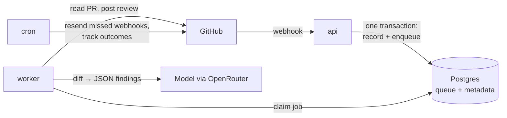

<p align="center"></p>

<h1 align="center">Selfreview</h1>

<p align="center"><b>A self-hosted AI code reviewer for GitHub.</b><br>
Deploy it to your own Railway project in one click. Your infrastructure, your model, your keys.<br>
About <b>$5–10 a month</b> for a 10-person team, instead of $240–480 for per-seat review SaaS.</p>

<p align="center"><a href="https://railway.com/deploy/selfreview"></a></p>

---

Open a pull request and Selfreview posts a review: specific, line-level comments on real bugs (security holes, broken logic, async mistakes, money math) that say what breaks, when, and how to fix it. One review per push, one summary comment edited in place, and nothing repeated on the next push.

See it on a live PR: **[selfreviewhq/demo#2](https://github.com/selfreviewhq/demo/pull/2)**. That review took 11 seconds and cost $0.0071.

## Why self-host a reviewer?

- **Cheap by default.** It uses open-weight models through [OpenRouter](https://openrouter.ai): GLM 5.3 costs about $0.002–0.007 per review. The whole Railway project idles at about $3/month.
- **Your code stays yours.** Diffs are processed in memory and never stored. The database keeps metadata only (which PR, which commit, cost, where comments went), never code or comment text.
- **Any model.** OpenRouter (GLM, DeepSeek, Qwen, Claude, GPT…), Anthropic, OpenAI, or your own vLLM/Ollama box: set the model and its provider's key.
- **Measured, not vibes.** [`eval/`](eval) is a reproducible benchmark: 30 small PRs (25 with a planted bug, 5 clean), 6 models × 3 runs, bugs caught and cost per bug. [Results](eval/RESULTS.md).

## Set up in two minutes

1. **Deploy on Railway** with the button above. Paste an [OpenRouter API key](https://openrouter.ai/keys) when asked. Everything else, including the database, secrets and domain, is created for you.
2. **Open your new app's URL**, log in with the `ADMIN_PASSWORD` shown in the api service's *Variables* tab, and click **Create GitHub App**. Choose your personal account or an organization.
3. **Install the app** on the repositories you want reviewed. Open a pull request.

That's it. The dashboard on the same URL shows spend, recent reviews, and how often comments get acted on.

## How it works



One Docker image runs as three Railway services (api, worker, cron; each takes its role from its service name), with Postgres as both the job queue and the database. The whole project is defined in one TypeScript file, [`.railway/railway.ts`](.railway/railway.ts).

Highlights from building it:

- **A job is a PR, not a commit.** Rapid pushes collapse into at most one running and one waiting review, and the last review always covers the newest commit.
- **Webhooks are never lost.** GitHub doesn't retry failed deliveries, so cron resends them (tested with a simulated outage).
- **Idempotent posting.** A crash after posting can't double-post; the retry adopts the existing review.
- **Safe by default.** Strangers' PRs aren't reviewed automatically (no running up your bill), a PR can't change its own review rules, and one-click suggestions that would delete code are dropped.

Read the full design in **[docs/ARCHITECTURE.md](docs/ARCHITECTURE.md)** and the build log, including everything that broke on the way, in **[docs/PLAN.md](docs/PLAN.md)**.

## Configuration

Railway variables on the **worker** service:

| Variable | Default | |
|---|---|---|
| `OPENROUTER_API_KEY` | — | Required unless you use another provider below |
| `MODEL_SMALL`, `MODEL_LARGE` | `openrouter:z-ai/glm-5.3` | `provider:model`. PRs under 400 changed lines get `MODEL_SMALL` |
| `ALLOWED_MODELS` | the two above + a few cheap OpenRouter models | Extra models a repo may choose |
| `MAX_REVIEW_COST_USD` | `1` | Skip PRs estimated to cost more |
| `MONTHLY_BUDGET_USD` | unset | Hard monthly cap: each review reserves its worst-case cost first, then settles to the actual cost, so neither parallel workers nor long answers can overshoot |
| `MODEL_PRICES` | — | JSON prices ($/1M tokens) for models without a built-in (Anthropic) or OpenRouter price, e.g. `{"openai:gpt-5-mini": {"input": 0.25, "output": 2}}`. Self-hosted models need `{"input": 0, "output": 0}`. A model with no price is skipped, never run uncapped. |
| `ANTHROPIC_API_KEY`, `OPENAI_API_KEY`, `OPENAI_COMPATIBLE_API_KEY` + `OPENAI_COMPATIBLE_BASE_URL` | — | Other providers |

Per repository, an optional **`.selfreview.yml`**. It's read from the base branch, so a PR can't loosen its own review:

```yaml
instructions: |
  We use Zod for validation; flag unvalidated request bodies.
ignore: ["**/*.snap", "migrations/**"]
risky_paths: ["src/auth/**"]   # always use MODEL_LARGE
min_severity: medium           # low | medium | high
max_comments: 15
skip_labels: ["no-review"]
```

Comment **`/selfreview`** on a PR to re-run a review. Maintainers can use it to review PRs from outside contributors.

## Development

```bash
bun install
bun test                 # unit tests; integration tests run when TEST_DATABASE_URL is set (CI does both)
bun run typecheck
bun eval/run.ts          # benchmark (needs OPENROUTER_API_KEY in .env)
```

Built with Bun, Hono, pg-boss, Octokit and Zod. [MIT licensed](LICENSE).
