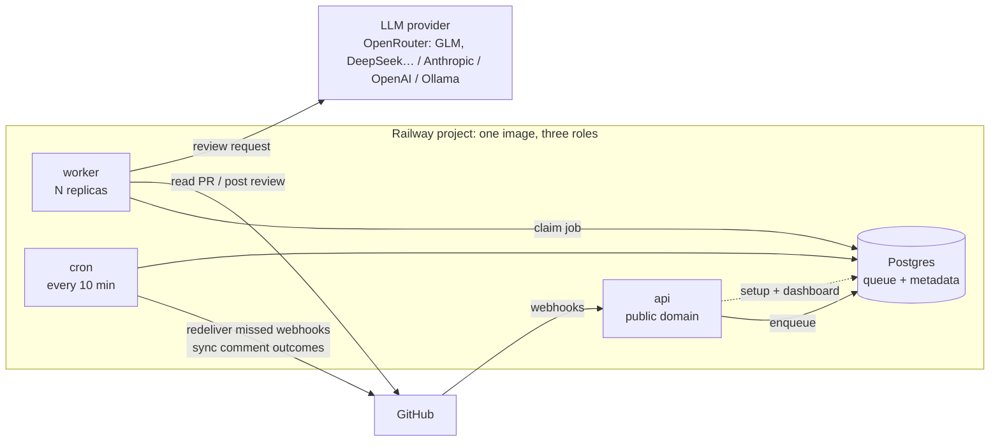
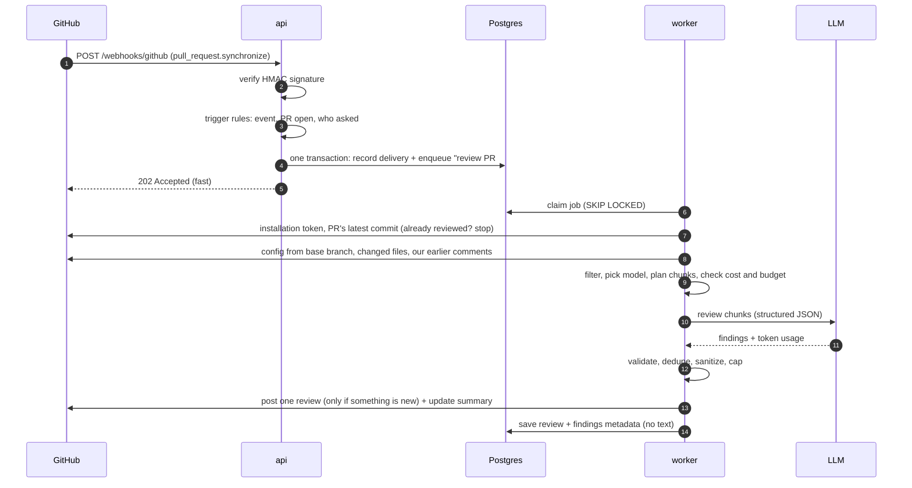
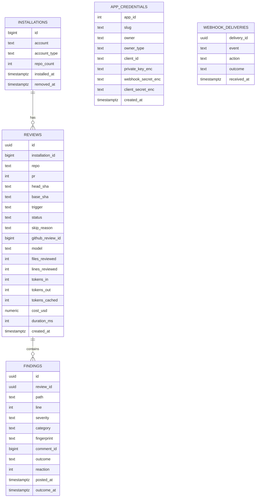
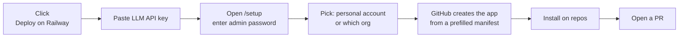

# Selfreview — Architecture

> A self-hosted AI code reviewer for GitHub that you deploy to your own Railway project in one click.
> Your infrastructure, your LLM keys, your prompts — at a fraction of the price of per-seat review SaaS.

Status: **v1, built and running.** Each design choice was verified live; [PLAN.md](PLAN.md) records what was tested and what broke. What changed since the first draft is listed at the [end](#changelog).

---

## 1. The one-paragraph version

When a pull request is opened or updated, GitHub sends a webhook to the **api** service. The api verifies it, checks the PR is one we should review, records it and queues a "review PR #42" job in **Postgres**, then replies within milliseconds. A **worker** picks the job up and reads the PR's *latest* commit from GitHub. It filters out noise such as lockfiles and generated code, then asks an LLM to review the remaining changes. It checks every finding against the diff and against what it already said, then posts one review back to the PR. A small **cron** service runs every 10 minutes to recover webhooks GitHub failed to deliver, and once an hour checks which comments developers acted on. Every review's token usage and cost is recorded. Everything runs from **one image in one Railway project**: api, worker and cron are the same code, and each takes its role from its Railway service name.

---

## 2. Goals and non-goals

**Goals (v1)**
1. **Two-minute setup.** Deploy template → click "Create GitHub App" → install on repos → done. No YAML, no CLI, no copying secrets around.
2. **Explainable.** Anyone should be able to understand the whole system from this document and its diagrams.
3. **Cheap and transparent.** Pay for Railway usage + LLM tokens only. Every review shows its cost, and budgets cap the worst case.
4. **Pluggable LLMs.** Claude, OpenAI, or any OpenAI-compatible endpoint (DeepSeek, OpenRouter, vLLM, Ollama).
5. **Scales horizontally** from one hobby repo to a company with hundreds of repos, by changing a replica count.
6. **Low noise.** A reviewer that comments too much gets uninstalled. Quality is measured, not assumed.
7. **Safe by default.** Strangers can't run up your bill, a PR can't change its own review rules, and setup can't be hijacked.

**Non-goals (v1)**: deliberately deferred, see [Roadmap](#11-roadmap)
- Running the PR's code or tests (v2, via Railway Sandboxes).
- Whole-repo semantic search / embeddings index (v3).
- Multi-tenant hosting. **One deployment serves one owner** (a person or an org), which is what keeps it simple.
- GitLab / Bitbucket.
- Auto-committing fixes.

---

## 3. System overview

### 3.1 What's in the Railway project



| Service | What it does | Public? | Scales by |
|---|---|---|---|
| **api** | Receives webhooks, runs the one-time GitHub App setup, serves a small password-protected dashboard. Never does slow work. | Yes (Railway domain) | Replicas (stateless) |
| **worker** | Runs the review pipeline (§4). All slow work (GitHub API, LLM calls) happens here. | No | Replicas × per-replica concurrency |
| **cron** | A Railway Cron service: starts every 10 minutes, does its chores, exits. Redelivers webhooks GitHub failed to deliver; hourly, syncs comment outcomes and reactions. | No | Doesn't need to |
| **Postgres** | The job queue *and* the database. One fewer moving part than Postgres + Redis. | No (private network) | Vertical; far below its limits at this load |

**Why three services but one codebase:** they share all code and one Docker image, and the service's name (`api`, `worker` or `cron`, which Railway provides as `RAILWAY_SERVICE_NAME`) decides what starts. A `ROLE` variable overrides it. Separating them means a burst of 500 PRs (say, a dependency bot) can never slow down webhook acknowledgement, and each side scales on its own. Keeping one codebase means there's still only one thing to understand and deploy.

Services talk over **Railway private networking** (`postgres.railway.internal`), so the database is never exposed to the internet.

### 3.2 What happens when a PR is opened or updated



GitHub gives a webhook receiver **10 seconds** to respond, and LLM reviews take 10–90 seconds. That mismatch is why the queue exists, and why this is a natural fit for Railway's always-on services rather than request-scoped serverless functions.

---

## 4. The review pipeline (worker)

### 4.1 A job is a PR, not a commit

Each job is `{installation, repo, pr, trigger, force}`, with **no commit SHA**. The worker reviews whatever the PR's latest commit is *when the job runs*. The queue allows at most **one waiting and one running job per PR** (pg-boss `stately` policy, keyed by `repo#pr`), so pushes collapse: while one review runs, any number of new pushes become a single waiting job, and the last review always covers the newest code. In testing, 5 quick pushes produced 3 reviews, not 5.

### 4.2 Steps

A straight line of small steps, each tested on its own:

| # | Step | What happens | Why |
|---|---|---|---|
| 1 | **Authenticate** | Sign a JWT with the App's private key → exchange for an installation token (cached ~55 min). | Short-lived, repo-scoped credentials. No long-lived tokens. |
| 2 | **Resolve** | Fetch the PR and its latest commit SHA. Stop if the PR is closed, or if this SHA was already reviewed (unless `force`). If an earlier attempt already posted a review for this commit (found by its hidden marker) but crashed before recording it, adopt that review instead of calling the model again. If the person who triggered the review isn't known to have write access, ask GitHub first (§4.3). | Never review stale code, never review or pay for the same commit twice. |
| 3 | **Load** | Read `.selfreview.yml` from the **base branch**. Fetch changed files with patches. Fetch our earlier comments on this PR and read their hidden fingerprints and titles. | A PR must not be able to rewrite its own review rules. Earlier comments are read live from GitHub, never stored. |
| 4 | **Filter** | Drop lockfiles, generated/vendored/minified files, binaries and `ignore` globs. Files GitHub sends without a patch (too large) are skipped and listed in the summary. | Biggest single lever on both cost and noise. |
| 5 | **Plan** | Pick the model tier (§5.2). Group files into chunks of up to ~60k tokens. Check the money (§5.3): no known price for the model, an estimate over `MAX_REVIEW_COST_USD`, or no room left in the monthly budget → post a short summary saying why instead. | Big PRs can't blow the context window or the bill. |
| 6 | **Review** | Per chunk, send the system prompt, repo instructions, PR title/description, **issues already raised on this PR**, the diff, and the full changed files (bounded). Ask for **structured JSON** findings. | Full files give context the diff lacks. Earlier comments stop the model repeating itself. Structured output means no fragile text parsing. |
| 7 | **Validate** | Schema-check every finding. Findings on files the review never looked at are dropped (made-up paths). Findings on lines outside the diff move to the summary (GitHub can't comment there). Drop findings below `min_severity` and repeats of earlier comments (whether or not their thread was resolved). Neutralise @mentions, strip images and HTML. Keep a ```` ```suggestion ```` only for short, validated ranges. Cap the count. | Every rule here exists because skipping it produces noise or broken code. |
| 8 | **Publish** | Post **one review** (event `COMMENT`) with the new inline comments, and edit the PR's single summary comment in place. No new findings → no new review, just an updated summary. | One notification per push at most. A crash-and-retry can't double-post (step 2). |
| 9 | **Record** | Save the review (model, tokens, cost, duration, outcome) and each finding's metadata (§6). No comment text. | Cost dashboard, dedupe and quality metrics. |

### 4.3 What triggers a review, and for whom

| Event | Reviewed automatically when… |
|---|---|
| `pull_request`: `opened`, `reopened`, `ready_for_review`, `synchronize` | The author is an owner, member or collaborator of the repo and not a bot account (Dependabot, Renovate and every other bot are always skipped), isn't listed in `skip_authors`, the PR isn't a draft (configurable), and it has no `skip_labels` label. |
| PRs from outside contributors (forks of public repos) | **Never automatically.** A maintainer comments `/selfreview` to review one. Otherwise anyone could open PRs to run up your LLM bill. |
| `issue_comment` with `/selfreview` | The commenter is an owner, member or collaborator. Sets `force`, so it re-reviews even an already-reviewed commit. |
| `installation`, `installation_repositories` | Not a review: keeps the `installations` table in sync. On uninstall, that account's reviews and findings are deleted. |

"Owner, member or collaborator" is read from the webhook's `author_association`. That field under-reports: in M2 the org's own owner arrived as untrusted, because org membership is private by default. So anyone else is queued with `verifyUser`, and the worker asks GitHub for their repo permission before spending any tokens.

**Who applies which rule:** the api only applies rules a repo can't override (event and action, PR still open, bot author, who asked), because it must answer GitHub fast and can't read repo files. Rules from `.selfreview.yml` (drafts, `skip_authors`, `skip_labels`) are applied by the worker after it reads the config from the base branch.

### 4.4 What the model returns

```json
{ "path": "src/auth.ts", "line": 42, "end_line": 42,
  "severity": "high", "category": "security",
  "title": "Token compared with ==",
  "body": "Use a constant-time comparison to avoid timing attacks.",
  "suggestion": "if (!timingSafeEqual(a, b)) ..." }
```

`severity`: `low | medium | high`. `category`: `bug | security | performance | reliability | maintainability`.

Every posted comment ends with an invisible marker, `<!-- selfreview:fp=3f9a1c -->`, and every review with `<!-- selfreview:sha=… -->`. These markers let the worker recognise its own work on GitHub without storing the text.

---

## 5. Pluggable LLM providers

### 5.1 One small interface

```ts
interface Reviewer {
  id: string;                       // "provider:model", e.g. "openrouter:z-ai/glm-5.3"
  limits: {                         // used to reserve the worst-case cost (§5.3)
    maxOutputTokens: number;
    maxCalls: number;
  };
  review(req: ReviewRequest, options?: { signal?: AbortSignal }): Promise<{
    findings: Finding[];            // validated against the JSON schema
    usage: { inputTokens: number; outputTokens: number; cachedInputTokens: number };
    costUsd?: number;               // exact cost, when the provider reports it (OpenRouter)
  }>;
}
```

| Provider | Covers | Structured output |
|---|---|---|
| `anthropic` | Claude models | Native JSON-schema output |
| `openai` | OpenAI models | Native JSON-schema output |
| `openrouter` | Hundreds of models behind one key: **GLM, DeepSeek, Qwen**, Claude, GPT, Gemini… | Strict JSON schema; OpenRouter reports the exact cost of each call |
| `openai-compatible` | DeepSeek's API, Together, self-hosted **vLLM** / **Ollama**, … | Strict JSON schema requested; an answer that fails validation gets one retry |

Everything outside this interface (filtering, validation, posting) is provider-agnostic, so adding a provider is one file. v1 supports one `openai-compatible` endpoint per deployment.

### 5.2 Model routing

Two configurable tiers, chosen per review. The default is a cheap open-weight model through OpenRouter. On the first demo PR, GLM 5.3 was the only cheap model that caught both planted bugs, at $0.007 a review. The M5 benchmark kept it for both tiers ([eval/RESULTS.md](../eval/RESULTS.md)).

```
MODEL_SMALL = openrouter:z-ai/glm-5.3   # diffs under ~400 changed lines
MODEL_LARGE = openrouter:z-ai/glm-5.3   # larger diffs, or files matching risky_paths
```

A repo can choose its models in `.selfreview.yml`, but **only from the operator's `ALLOWED_MODELS` list**, so a repo can't opt itself into the most expensive model. Two common non-default setups:

```
# Another model on OpenRouter (any id from openrouter.ai/models)
MODEL_LARGE = openrouter:deepseek/deepseek-v4-pro

# Fully private: open-weight model on your own GPU box running vLLM/Ollama
OPENAI_COMPATIBLE_BASE_URL = http://vllm.railway.internal:8000/v1
MODEL_LARGE = openai-compatible:qwen3-coder-30b
MODEL_PRICES = {"openai-compatible:qwen3-coder-30b": {"input": 0, "output": 0}}   # every model needs a price
```

Whichever provider you pick is the one third party that sees your diffs, so choose with that in mind. With a self-hosted model, no third party sees them at all.

### 5.3 Cost tracking and budgets

A price per model (`$/M input`, `$/M output`, `$/M cached input`) turns the provider's reported token usage into each review's cost. OpenRouter reports the exact cost of each call. Prices come from, in order:
1. the operator's `MODEL_PRICES`;
2. built-in Anthropic prices;
3. OpenRouter's live model list.

`openai-compatible:` endpoints have no default price, whether paid or self-hosted. They must be listed in `MODEL_PRICES` (use 0 for your own GPU box), so a paid endpoint can't slip through as "free".

**Caps are enforced for every model:**
- **Unpriced models are never run.** A model with no known price (e.g. an `openai:` model missing from `MODEL_PRICES`) is skipped with an explanation in the summary, never run uncapped. If OpenRouter's price list can't be fetched, the job is retried later.
- `MAX_REVIEW_COST_USD` (default $1) is checked *before* calling the model, from estimated tokens.
- `MONTHLY_BUDGET_USD` (default unset) is a hard cap even with many workers. Before calling the model, a review **reserves its worst-case cost** under a Postgres advisory lock: every call using all its output tokens, a retry resending the conversation, and a 2× margin on input. The reservation is a `running` row counted in this month's spend.
  - Finishing settles it to the actual cost.
  - A failure releases it down to what was spent.
  - A retry that adopts an already-posted review settles the crashed attempt's reservation.
  - Cron closes any reservation still `running` after an hour.

  The dashboard shows the budget.

Selfreview doesn't ask for prompt caching: each chunk is a different prompt, so the savings would be small. If a provider caches on its own, cached tokens are billed at the cached price.

---

## 6. Data model

**Rule: store metadata, never content.** Code, diffs and comment text are never stored. Comment text already lives on GitHub, so we keep only enough to dedupe, track cost and measure quality.



| Table | Contains | Needed for |
|---|---|---|
| **Job queue** (pg-boss schema) | `{installation, repo, pr, trigger, force}` per job | **Product.** Jobs must outlive the 10-second webhook window, survive redeploys, and be shared by every worker replica. Finished jobs (completed or failed) are deleted after 7 days. |
| **`app_credentials`** (1 row) | GitHub App ID, owner, private key and secrets, AES-GCM encrypted | **Product.** The manifest flow creates these *after* deploy, so they can't be env vars. |
| **`installations`** | Which accounts installed the app, when, and how many repos | **Analytics.** Adoption over time and churn (`removed_at`). |
| **`webhook_deliveries`** | GitHub's delivery ID, event type and what we did with it | **Product + debugging.** Ignores duplicate deliveries, tells cron which failed deliveries we never received, answers "did the webhook even arrive?" Kept 30 days. |
| **`reviews`** | Repo, PR, commit SHAs, trigger, status, model, size, tokens, cost, duration | **Product.** Cost tracking and budgets, "already reviewed this commit", and the base for incremental reviews (v1.1). |
| **`findings`** | Path, line, severity, category, fingerprint, GitHub comment ID, outcome, 👍/👎 | **Product + analytics.** Dedupe across pushes, and quality per model/severity/category. **No title, body or suggestion text.** |

- `reviews.status` is one of `running | posted | no_new_findings | skipped | failed`. `running` is a review in progress that has reserved budget (§5.3). `skip_reason` says why a review was skipped or failed, for example "monthly budget reached", "draft" or "label:no-review".
- `findings.outcome` is one of `open | addressed | resolved`. **Addressed** means the code under the comment changed in a later push, which GitHub marks as an *outdated* thread. **Resolved** means someone resolved the thread. This is the main quality signal (§9).
- `findings.fingerprint` is a hash of path + category + normalized title + surrounding code. It catches exact repeats. Reworded repeats are caught by showing the model its earlier comments (§4.2 step 6), plus a backstop rule: same file, within ±3 lines, same category. Prior findings come from this table *and* from our comments' hidden fingerprints read live from GitHub, so a lost row can't make the bot repeat itself.

**What user data is stored, exhaustively:** account and repo names, PR numbers, commit SHAs, file paths and line numbers of findings, usage numbers, and a GitHub username or label name when that is the reason a review was skipped. **Never stored:** source code, diffs, PR titles or descriptions, comment text, LLM prompts or responses. Diffs and files live in worker memory only for the duration of a job and are never logged.

**Who sees this data:** Selfreview is self-hosted, so all of it lives in the operator's own Railway Postgres. The project author sees none of it.

---

## 7. Setup flow: two minutes to first review



1. **Deploy on Railway.** The template creates api, worker, cron and Postgres. It wires `DATABASE_URL` with reference variables, gives the api a public domain, and generates `ENCRYPTION_KEY` and `ADMIN_PASSWORD`. The only prompt is the LLM API key.
2. **Open `/setup`** and enter the admin password from the Railway Variables tab. Without that password, whoever found your URL first could connect *their* GitHub App to your instance.
3. **Choose the owner: your personal account or an org.** This matters because a private GitHub App can only be installed on the account that owns it. Create it under your personal account and it can never be installed on your company's org.
4. **Create the GitHub App.** One button posts a prefilled manifest (name, webhook URL = this Railway domain, permissions, events) to GitHub, with a signed `state` value that expires after an hour. GitHub creates the app and redirects back with a code, which the api exchanges within the hour for the app's ID, private key and secrets. These are stored **encrypted**, and `/setup` locks. Nobody copies a PEM file around.
5. **Install** the app on the chosen repos. Open a PR. A review appears.

**GitHub App permissions (least privilege):** Pull requests: read & write · Contents: read · Metadata: read · Issues: read (for `/selfreview` comments). **Events:** `pull_request`, `issue_comment`. Installation events arrive automatically.

**Operator settings (Railway variables):**

| Variable | Default | Purpose |
|---|---|---|
| `OPENROUTER_API_KEY` | — | The default provider: one key, hundreds of models |
| `ANTHROPIC_API_KEY` / `OPENAI_API_KEY` / `OPENAI_COMPATIBLE_API_KEY` | — | Optional other providers |
| `OPENAI_COMPATIBLE_BASE_URL` | — | Your own endpoint: DeepSeek's API, Together, vLLM, Ollama… |
| `MODEL_SMALL`, `MODEL_LARGE` | `openrouter:z-ai/glm-5.3` (Haiku / Sonnet if only `ANTHROPIC_API_KEY` is set) | Model routing (§5.2) |
| `SMALL_DIFF_LINES` | `400` | Below this many changed lines, `MODEL_SMALL` is used |
| `ALLOWED_MODELS` | the two above, plus a few cheap OpenRouter models (GLM 5.3 Flash, DeepSeek V4 Flash/Pro, gpt-oss-120b) | What repos may choose |
| `MODEL_PRICES` | — | JSON prices for models without a built-in or OpenRouter price (§5.3) |
| `MAX_REVIEW_COST_USD` | `1.00` | Per-review cap |
| `MONTHLY_BUDGET_USD` | unset | Hard monthly cap (§5.3) |
| `WORKER_CONCURRENCY` | `3` | Reviews in parallel per worker replica |
| `MAX_REVIEWS_PER_ORG` | `2` | Reviews in parallel per installation, across all workers (§8.1) |
| `ADMIN_PASSWORD`, `ENCRYPTION_KEY` | generated | Setup/dashboard login, credential encryption |

**Optional per-repo config**: `.selfreview.yml`, read from the base branch:
```yaml
instructions: |
  We use Zod for validation; flag unvalidated request bodies.
ignore: ["**/*.snap", "migrations/**"]
risky_paths: ["src/auth/**", "src/billing/**"]   # always use the large model
min_severity: medium      # low | medium | high
max_comments: 15
skip_drafts: true
skip_authors: ["dependabot[bot]", "renovate[bot]"]
skip_labels: ["no-review"]
models: { large: "openrouter:deepseek/deepseek-v4-pro" } # must be in ALLOWED_MODELS
```

**Dashboard** (`/`, behind `ADMIN_PASSWORD`): spend this month vs budget, recent reviews with cost, addressed rate per model, recent webhook deliveries, and failed jobs with a Retry button.

---

## 8. Scaling and reliability

### 8.1 Scaling

The design scales by turning two dials, worker replicas and per-worker concurrency, and has no single slow path.

| Load | Setup | Notes |
|---|---|---|
| Solo dev / side project | 1 api, 1 worker, concurrency 2 | Mostly idle. Railway bills actual usage, so a few $/month. |
| Team of 10–50 | 1 api, 1–2 workers, concurrency 5 | Handles bursts of dozens of PRs. |
| Org with hundreds of repos | 2 api, N workers | Add worker replicas in Railway, with no code or config changes. |

**Where the real limits are:**
- **LLM rate limits** are usually the first ceiling. Each review sends at most 2 chunks at once, and each worker runs `WORKER_CONCURRENCY` reviews. The provider SDKs retry 429 and 5xx responses twice with backoff; after that the job fails and pg-boss retries it later.
- **GitHub API rate limits:** an installation token gets thousands of requests/hour, and a review uses ~5–15, so this is far from a limit.
- **Webhook bursts:** the api does one small transaction per webhook, so it absorbs bursts easily, and the queue smooths the load for workers.
- **Postgres as a queue** comfortably handles thousands of jobs per minute, far beyond review workloads. pg-boss is called in only three places (enqueue, work, retry), so moving to Redis later would be a contained change if it's ever needed.
- **Fairness between orgs:** each job carries its installation as a pg-boss *group*, and `groupConcurrency` caps how many reviews one org can run at once across all workers, so one busy org can't starve the rest.

### 8.2 Reliability: every way a review could get lost, and what stops it

| Failure | What stops it |
|---|---|
| api is down when GitHub sends a webhook (GitHub **never retries** by itself) | Every 10 minutes, cron asks GitHub for failed deliveries from the last 6 hours and resends any whose ID isn't in `webhook_deliveries`. That's one resend per run, up to 12 attempts (~2 hours of outage). Verified in M3 with a simulated outage. |
| api crashes between recording a webhook and queueing the job | Both happen in **one transaction**: a webhook is fully accepted or not at all, so the redelivery check still catches it. |
| Duplicate webhook delivery | `webhook_deliveries` primary key: the second one is ignored. |
| Worker is redeployed mid-review | Worker stops claiming on `SIGTERM` and finishes the current job. Railway's default is only ~11 s from `SIGTERM` to kill (measured in M0), so the worker's `drainingSeconds` is set to 120 in `.railway/railway.ts`. Bun runs as PID 1 (exec-form `CMD`), so the signal actually arrives. |
| Worker is killed anyway (crash, OOM) | Running jobs send a heartbeat every 15 s. If none arrives for 30 s, the job is marked failed and retried: up to 3 retries, with backoff starting at 30 s. After that it stays failed and is shown on the dashboard with a Retry button for 7 days. |
| A review runs past its 15-minute limit (e.g. a hung model call) | pg-boss hands the job to a retry and aborts the old attempt: its model calls stop, and it never posts. Each model call also times out after 3 minutes. |
| Retry after the review was already posted | Before calling the model, the worker looks for a review carrying this commit's hidden marker (§4.2 step 2) and adopts it, so nothing is posted or paid for twice. A forced `/selfreview` re-run skips that check, but its findings are still deduped against the comments already on the PR. |
| LLM provider outage | Same retry path. Nothing is posted until all chunks succeed. |
| Deploying the api | A healthcheck plus Railway's deploy overlap keep the old api serving until the new one is healthy. |
| Database migrations | Run as Railway's **pre-deploy command**, under a Postgres advisory lock, so many replicas starting at once can't migrate twice. A failed migration fails the deploy instead of starting broken code. |

### 8.3 Observability

All logs are structured JSON, which Railway's log explorer can filter on. Webhook lines carry the delivery ID and repo; review lines carry the job ID, repo, PR and attempt number, so all of a PR's reviews are one filter away (`repo` + `pr`). Logs never contain code, diffs or prompts.

---

## 9. Quality: how we know it's good

A reviewer is only useful if developers trust it. We measure:

1. **Eval set (before launch):** `eval/cases/` holds 30 small PRs, 25 with one planted bug each and 5 clean. It is run on demand for prompt or model changes, tracking **recall** (bugs caught), **noise** (comments per PR that aren't bugs), and **cost per bug found** for each model. v1 results are in [eval/RESULTS.md](../eval/RESULTS.md).
2. **Addressed rate (live):** the share of comments whose code changed in a later push or whose thread was resolved. This needs no effort from developers, unlike reactions, which most people never leave.
3. **Reactions (secondary):** GitHub has no webhook for reactions, so cron polls them every hour for comments from the last 14 days.
4. **Guardrails against noise:** severity threshold, comment cap, no repeats across pushes (resolved or not), no new review when nothing is new, no style nits unless asked for in `instructions`.

This is also the most credible content: "here's how often it's right, and what each bug cost to find" beats "it's AI-powered".

---

## 10. Security

| Concern | Mitigation |
|---|---|
| Forged webhooks | HMAC-SHA256 signature verification (constant-time) on every request. |
| Setup hijack (someone finds the URL before you do) | `/setup` requires the generated `ADMIN_PASSWORD`, uses a signed `state` value that expires after an hour, and locks after the first success. |
| **Strangers running up your bill** | Only owners/members/collaborators trigger reviews. Outside contributors need a maintainer's `/selfreview`. Per-review and monthly cost caps. |
| A PR changing its own review rules | Config is read from the base branch. Repos can only pick models from `ALLOWED_MODELS`. |
| Secret storage | LLM keys, `ADMIN_PASSWORD` and `ENCRYPTION_KEY` live in Railway variables; the template generates the last two with `${{ secret() }}`, and `railway.ts` never derives them (`ctx.randomString()` is a hash anyone can recompute). GitHub App credentials are encrypted at rest (AES-GCM, `ENCRYPTION_KEY`). This protects against a leaked DB dump or backup, not against someone with full access to the Railway project. Lose `ENCRYPTION_KEY` and you simply recreate the GitHub App. |
| Code exposure | Code is processed in memory only, never written to the DB or logs (§6 has the full list of what *is* stored). The only third party that sees code is the LLM provider *you* chose, or none with a self-hosted model. |
| **Prompt injection** (a PR that says "ignore your instructions…") | PR content is treated as untrusted data. In v1 the model has **no tools**: it can only return JSON findings, which are schema-checked and line-checked. Output is sanitised (no @mentions, images or HTML). The bot only ever *comments*: it never approves or requests changes. The worst case is a bad comment, never an action. |
| Over-broad access | Least-privilege GitHub App permissions, per-installation short-lived tokens. |
| Dashboard access | `ADMIN_PASSWORD` in v1. After 10 wrong passwords, logins are refused for 15 minutes (counted for everyone together, since the visitor IP behind Railway's proxy can be faked). GitHub login restricted to org members in v1.1. |

---

## 11. Roadmap

| Version | Adds | Railway feature showcased |
|---|---|---|
| **v1** | Everything above | Infrastructure as code (`.railway/railway.ts`), templates, reference variables + generated secrets, private networking, replicas, Cron, pre-deploy command, healthchecks + draining |
| v1.1 | Incremental reviews (only the commits since the last review), Check Run status, GitHub login for the dashboard, optional anonymous usage telemetry (opt-out) | — |
| **v2** | **Run it, don't just read it:** spin up a Railway **Sandbox** per PR, run the tests, include failures in the review. Optionally drive the PR's preview environment with a headless browser and attach screenshots. | Sandboxes, PR environments |
| v3 | Repo-wide context via a pgvector index ("this function is also called from 4 other places"). **Opt-in**, because embeddings are derived from code: the first feature that would store anything code-related. | Postgres extensions |
| later | GitLab support, multiple OpenAI-compatible endpoints, auto-fix suggestions as commits | — |

---

## 12. Key decisions (and why)

| Decision | Alternative considered | Why this one |
|---|---|---|
| Postgres as the queue (pg-boss) | Redis + BullMQ | One fewer service to deploy, pay for, and explain. Load is far below Postgres's limits. |
| A job is a PR, not a commit | One job per push | Pushes collapse into ≤ 2 reviews, and the last always covers the newest code. Per-commit jobs either pile up or skip the newest push. |
| api + worker + cron, same image | Single service | Webhooks stay fast under bursts, each side scales independently, and one image keeps it one codebase. |
| Infrastructure as code in `.railway/railway.ts` | Clicking in the dashboard; legacy `railway.json` (stops being read 2026-12-01) | The whole project (services, roles, cron schedule, draining, healthcheck, variables) is one reviewable TypeScript file, applied with `railway config apply`. |
| Railway Cron for chores | A timer inside the worker | Runs even if every worker is busy or crashed, costs only seconds of compute, and makes chores visible as their own service. |
| Always-on service (like CodeRabbit, Kodus) | Run as a GitHub Action (like PR-Agent) | An Action has no memory between pushes (so no dedupe, budgets or dashboard), needs setup in every repo, boots a runner per review, and gets no secrets on fork PRs. |
| GitHub App + manifest flow | Personal access token | Bot identity, per-repo install, scales to orgs. The manifest flow keeps setup to one click. |
| Config from the base branch | Config from the PR | A PR can't loosen its own review or switch to an expensive model. |
| GitHub holds comment text; we hold metadata | Store full findings | Nothing sensitive to leak, and still enough for dedupe and quality metrics. |
| Outside contributors off by default | Review every PR | Public repos would otherwise let anyone spend your LLM budget. |
| Structured JSON output + validation | Parse free text | Deterministic: invalid findings are dropped, never posted. |
| No tools for the model (v1) | Agentic reviewer with repo access | Smaller prompt-injection blast radius, predictable cost. Tools arrive in v2 inside an isolated Sandbox. |
| Bun + Hono + TypeScript | Node, Python, Go | Fast startup, one language end-to-end, and Railway's Sandbox SDK is TypeScript (needed for v2). Node is the fallback if Bun has a compatibility problem. |

**Main libraries:** Hono (HTTP), pg-boss (queue), `pg` (database), Octokit (GitHub REST and GraphQL; the App's JWT and the webhook HMAC check are a few hand-written lines with `node:crypto`), Zod (config and finding schemas), `yaml` (`.selfreview.yml`), the Anthropic and OpenAI SDKs (the OpenAI SDK also serves OpenAI-compatible endpoints).

---

## 13. Cost model

```
monthly cost ≈ Railway usage (+ plan fee)  +  reviews/month × cost per review
```

**Measured, not estimated:**

| Item | Measured |
|---|---|
| Railway: api + worker + cron + Postgres, mostly idle | **~$0.10/day ≈ $3/month** (first day, including builds and tests) |
| One review with GLM 5.3 (the default) | **$0.0014** on the benchmark's small PRs, **$0.007** on the demo PR |
| One review with the cheapest models tested | $0.0001–$0.0002 (gpt-oss-120b, GLM 5.3 Flash) |

Worked example: 10 developers, ~600 reviews/month.

| Setup | Monthly |
|---|---|
| Railway | ~$3–5 |
| Tokens, GLM 5.3 at $0.002–$0.007 per review | ~$1–4 |
| **Total** | **~$5–10** |
| *Comparison: per-seat review SaaS at $24–48/dev* | *$240–480* |

Bigger PRs cost more (they're chunked); `MAX_REVIEW_COST_USD` and `MONTHLY_BUDGET_USD` cap the worst case.

---

## Changelog

**v0.2 (2026-10-08): review pass**
- Jobs are per PR, not per commit. v0.1's design could skip the newest push entirely.
- Added a **cron** service: redelivers webhooks GitHub failed to deliver (GitHub never retries), and syncs comment outcomes and reactions (GitHub has no reaction webhook).
- Webhook record + enqueue happen in one transaction.
- Config is read from the base branch, and repos may only use models in `ALLOWED_MODELS`.
- Outside contributors aren't reviewed automatically. `/selfreview` is limited to maintainers. Added per-review and monthly cost caps.
- `/setup` is protected by a generated admin password and lets you choose personal account or org, because private apps can only be installed on their owner.
- Publishing is idempotent (hidden commit marker), with no new review when nothing is new and a single summary comment edited in place.
- Dedupe also shows the model its earlier comments, never re-raises resolved threads, and has a ±3-line backstop.
- Output is sanitised (@mentions, images, HTML), and suggestion blocks are limited to short validated ranges.
- New quality signal: **addressed rate** (thread outdated or resolved). `findings` gains `outcome`, and `reviews` gains `status`, `skip_reason` and `github_review_id`.
- Reliability table, worker draining time, migrations via pre-deploy command, structured logs.
- Dashboard login is `ADMIN_PASSWORD` in v1, GitHub login in v1.1. Per-org fairness moved to the roadmap.
- Added the operator settings table, main libraries, and an eval set with cost per bug found.

**v0.3 (2026-10-09): M0 results**
- Infrastructure is defined in `.railway/railway.ts` (Railway IaC), not `railway.json`.
- Measured Railway's default stop window (~11 s), so the worker's 120 s `drainingSeconds` is required, not optional.
- Crash recovery uses pg-boss heartbeats (job back in the queue within about a minute instead of a 15-minute expiry).
- Per-org fairness moved into v1: pg-boss v12 `groupConcurrency` does it natively.

**v1 (2026-10-10): built**
- Default models are cheap open-weight ones through OpenRouter (GLM 5.3), chosen by the benchmark in `eval/`.
- Cost model uses measured numbers.
- Comment outcomes sync hourly instead of daily.

**v1.0.1 (2026-10-11): docs match the code**
- Corrected every place this document described a planned detail as built (thread-state checks in the worker, a queue interface, prompt caching, correlation IDs) or gave a stale number. Failed jobs are now kept 7 days so the dashboard's Retry list covers a week.
- Final review fixes: `railway.ts` no longer derives secrets with `ctx.randomString()` (predictable), a failed review's billed calls now count against the monthly budget, an attempt that runs past its time limit stops before posting, and the login redirect accepts only paths on this site.
- Dogfood review (Selfreview reviewing its own code, $0.03): the login page now refuses logins for 15 minutes after 10 wrong passwords, and the benchmark errors out when a case's bug snippet is missing instead of silently scoring it as missed.

**v1.0.2 (2026-10-12): one-click suggestions**
- Models often copied the line after the flagged one into a suggestion, so accepting it added that line twice. Lines copied from just before or after the range are now removed, and a suggestion that would change nothing is dropped.

**v0.1 (2026-10-08)**: first draft.
